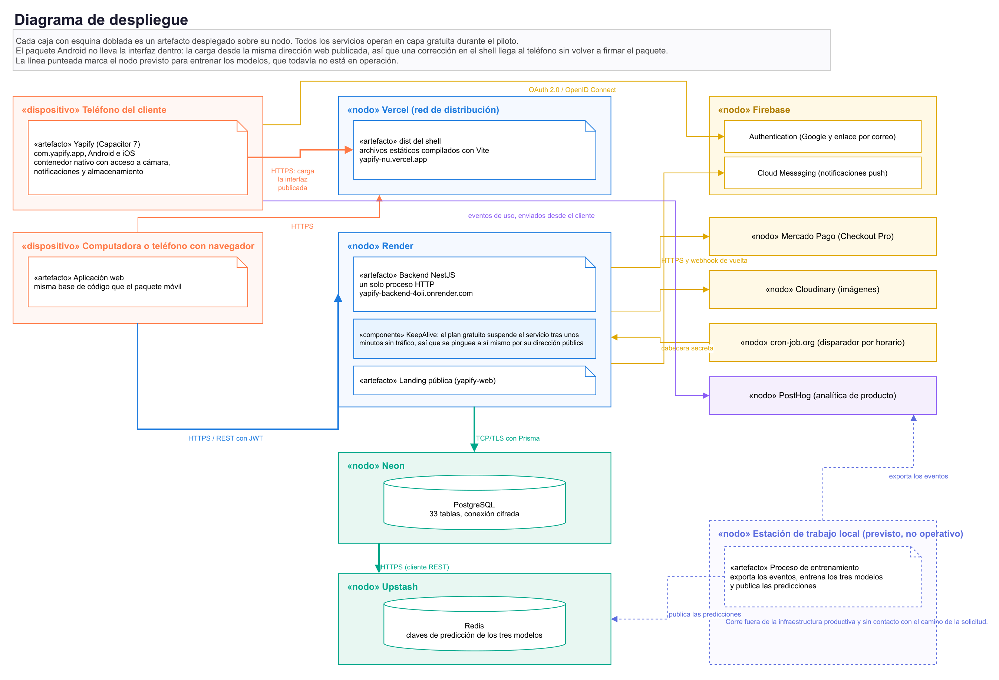
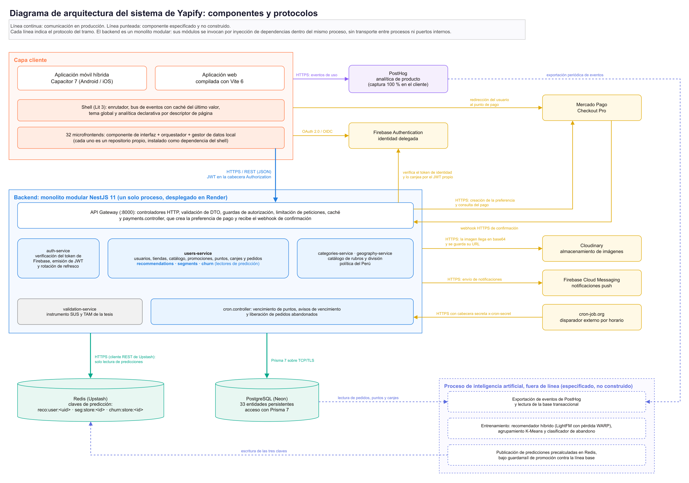
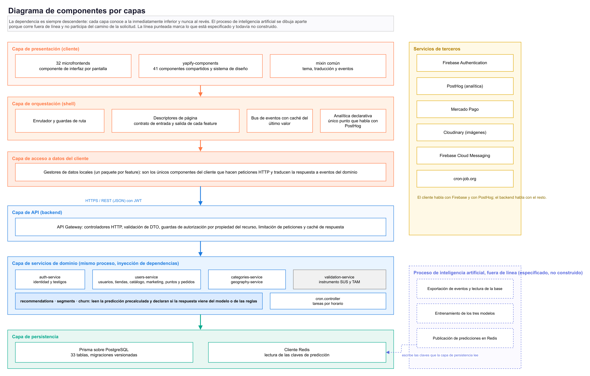
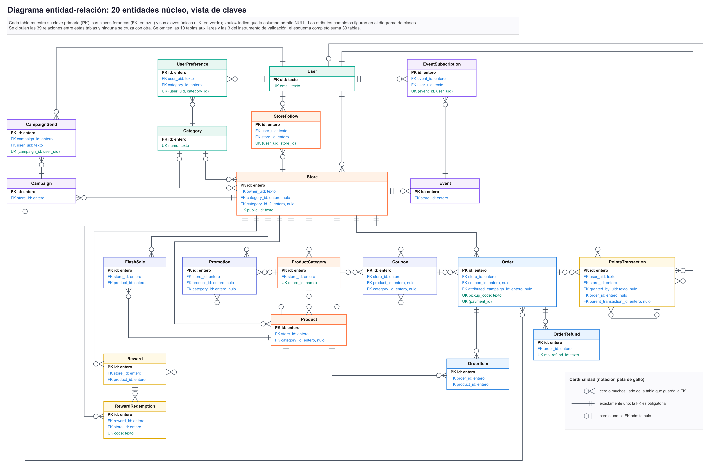
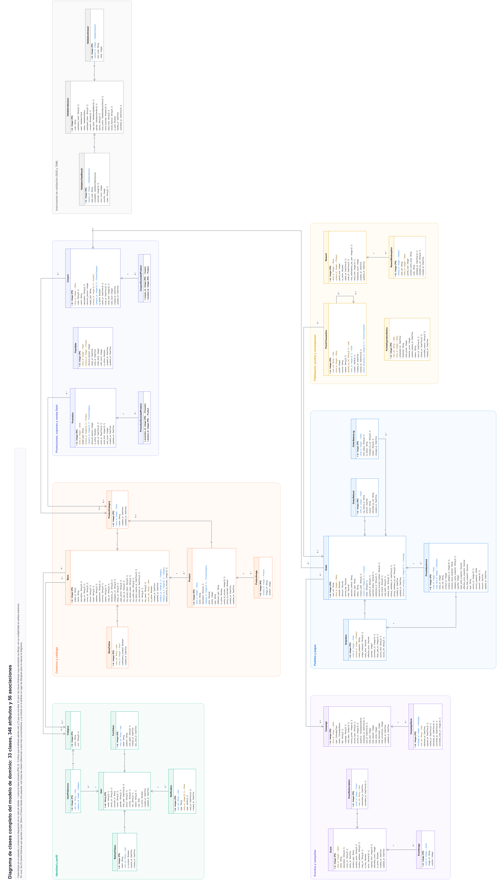
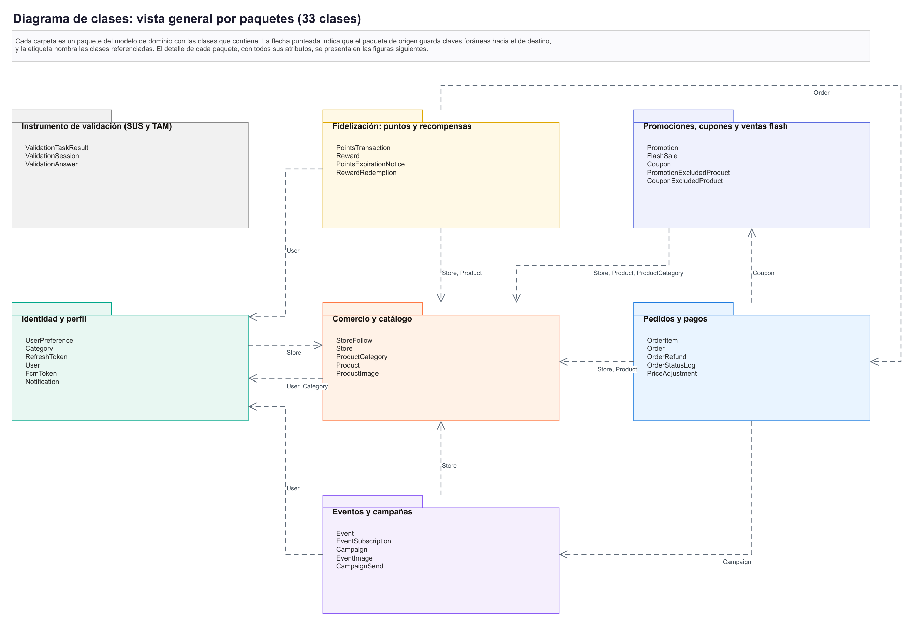

# Yapify

**Programa de fidelización multitienda para comercios minoristas de Arequipa.**

Yapify es una aplicación móvil y web que reúne en un solo lugar los beneficios de
distintos comercios: el cliente compra, junta puntos en cada tienda y los canjea por
productos de esa misma tienda; el dueño administra su negocio desde un panel propio,
con el mismo usuario y sin instalar otra aplicación.

Este repositorio contiene el **shell del front** (la aplicación que carga cada pantalla),
el **APK de Android**, la documentación técnica y los manuales de uso.

## Probar Yapify

Hay dos formas de usar la aplicación, con el mismo sistema detrás:

| Opción | Cómo |
|---|---|
| **Web** | Abre **<https://yapify-nu.vercel.app>** en el navegador del celular o de la computadora. No hay que instalar nada. |
| **Android (APK)** | [Descargar el APK](https://raw.githubusercontent.com/jpaulmm1005/yapify-frontend/main/apk/yapify-debug.apk) e instalarlo con los [pasos de abajo](#cómo-instalarla). |

> [!IMPORTANT]
> **Disclaimer:** la aplicación puede tardar en cargar la primera vez, hasta cerca de un
> minuto. No es un error: se debe al *cold start* del servicio gratuito donde está alojada.
> Espera sin cerrarla y después funciona con normalidad.

---

## Contenido

1. [De qué trata](#de-qué-trata)
2. [La tesis](#la-tesis)
3. [Qué hace el sistema](#qué-hace-el-sistema)
4. [Arquitectura](#arquitectura)
5. [Diagrama de componentes](#diagrama-de-componentes)
6. [Modelo de datos](#modelo-de-datos)
7. [Diagrama de clases](#diagrama-de-clases)
8. [Casos de uso y secuencias](#casos-de-uso-y-secuencias)
9. [Video explicativo](#video-explicativo)
10. [Manuales de usuario](#manuales-de-usuario)
11. [Aplicación Android (APK)](#aplicación-android-apk)
12. [Estructura del repositorio](#estructura-del-repositorio)
13. [Licencia](#licencia)

---

## De qué trata

En el pequeño comercio de Arequipa, la fidelización se hace casi siempre con tarjetas
físicas, sellos y cupones en papel. Esos soportes se extravían, no se pueden
personalizar y no dejan ningún dato sobre cómo compra el cliente.

Yapify sustituye esos soportes por una cuenta única:

- **El cliente** descubre tiendas, las sigue, compra con Mercado Pago, recoge su pedido
  con un código QR, acumula puntos por tienda y los canjea.
- **El dueño** carga su catálogo, publica promociones, cupones, ventas flash, eventos y
  canjes, da puntos en caja, entrega pedidos, escribe a sus clientes y sigue sus ventas.
- **El sistema** registra el uso y prepara tres capacidades de inteligencia artificial
  para el comercio: recomendación de ítems, segmentación de clientes y predicción de
  abandono.

Los puntos son **por tienda**: cada comercio lleva su propio saldo, sus propios canjes y
sus propias campañas. No existe una bolsa común de puntos.

## La tesis

Yapify es el producto de software de la siguiente tesis:

> **Diseño e implementación de una aplicación móvil de fidelización multitienda con
> recomendación adaptativa e inteligencia artificial para comercios minoristas de
> Arequipa: evaluación de usabilidad y aceptación tecnológica**

| | |
|---|---|
| **Autores** | Luis Fernando Luque Nieto · Jean Paul Mamani Motta |
| **Asesor** | Richart Smith Escobedo Quispe |
| **Grado** | Ingeniero de Software |
| **Institución** | Escuela Profesional de Ingeniería de Software, Universidad La Salle, Arequipa, Perú |
| **Año** | 2026 |

El desarrollo siguió una metodología iterativa e incremental con prácticas de Scrum. La
evaluación con usuarios se diseñó con la escala SUS (usabilidad) y el modelo TAM
(aceptación tecnológica).

**Estado del módulo de inteligencia artificial.** El backend ya consume las predicciones
de recomendación, segmentación y abandono desde Redis, declara en cada respuesta de dónde
viene el dato y cae a reglas simples cuando todavía no existe una predicción. Los modelos
no se entrenaron ni se evaluaron con tráfico real, porque la aplicación aún no acumula uso
cotidiano, y por eso no se publican métricas de desempeño.

## Qué hace el sistema

### Modo cliente

Registro con Google o con enlace por correo · inicio personalizado «Para ti» ·
exploración y búsqueda de tiendas · seguir tiendas y activar sus avisos · tienda pública
con productos, promociones, cupones, ventas flash, eventos y canjes · carrito por tienda
con cupones · pago con Mercado Pago · código QR de retiro · historial de compras ·
billetera de puntos con vencimiento por lote · canje de puntos · mis eventos con código de
entrada · notificaciones dentro de la app y por push · perfil, preferencias y tema.

### Modo tienda

Creación y configuración de la tienda · productos y servicios con categorías propias ·
promociones (por producto, por categoría o por categoría con excepciones) · cupones ·
ventas flash con stock · canjes con límite por persona · eventos con aforo y código de
entrada · asignación de puntos por QR · validación de pedidos, canjes y entradas en un
mismo escáner, con vista previa antes de consumir el código · clientes · campañas con
audiencias y programación · ventas, devoluciones y rankings · estadísticas por periodo ·
configuración de la tienda.

## Arquitectura

El sistema se despliega sobre servicios en capa gratuita: la interfaz en **Vercel**, el
backend NestJS en **Render**, la base PostgreSQL en **Neon** y las predicciones en
**Upstash (Redis)**. El paquete Android (Capacitor) no lleva la interfaz adentro: carga la
misma dirección web publicada, así que una corrección en el front llega al teléfono sin
volver a firmar el paquete.

### Diagrama de despliegue



### Arquitectura: componentes y protocolos

Cada línea indica el protocolo de comunicación de ese tramo. El cliente consume la API por
HTTPS/REST con JWT; la identidad se delega en Firebase Authentication; el pago usa el flujo
del lado del servidor de Mercado Pago con confirmación por webhook; el cliente envía sus
eventos de uso directamente a PostHog.



## Diagrama de componentes

El front se organiza como una **arquitectura de microfrontends**: un *shell* que enruta y
carga cada pantalla bajo demanda, y un microfrontend por funcionalidad. Cada microfrontend
trae su propio gestor de datos (`local-*-dm`), que es el único componente que hace
peticiones HTTP. Los componentes visuales compartidos viven en `yapify-components`.

Cada microfrontend, cada gestor de datos y la biblioteca de componentes son repositorios
independientes. **No están en este repositorio:** el shell los declara como dependencias
en su `package.json` y se instalan desde ahí.



Versiones vectoriales (ampliables sin pérdida) en
[`docs/diagramas/arquitectura`](docs/diagramas/arquitectura).

## Modelo de datos

El esquema relacional tiene 33 tablas en seis dominios: identidad, tiendas, catálogo,
marketing, fidelización y pedidos. El diagrama muestra las 20 entidades núcleo en la vista
basada en claves, con sus 39 relaciones en notación de pata de gallo.



## Diagrama de clases

El modelo de dominio tiene 33 clases persistentes, generadas a partir del esquema de
Prisma. Se presenta completo, por paquetes y con el detalle de cada paquete.





Detalle de cada paquete en [`docs/diagramas/clases`](docs/diagramas/clases):
identidad y perfil · comercio y catálogo · promociones, cupones y ventas flash · eventos y
campañas · fidelización · pedidos y pagos · instrumento de validación.

## Casos de uso y secuencias

Diagramas de casos de uso por paquete funcional en
[`docs/diagramas/casos-de-uso`](docs/diagramas/casos-de-uso) y diagramas de secuencia de
los flujos principales en [`docs/diagramas/secuencia`](docs/diagramas/secuencia).

## Video explicativo

Recorrido completo del sistema, construido a partir de los manuales.

> _Enlace pendiente de publicar._

<!-- Reemplazar la línea anterior por: [Ver el video](URL) -->

## Manuales de usuario

| Manual | Para quién | Contenido | PDF |
|---|---|---|---|
| **Manual de usuario** | Clientes de las tiendas | Entrar y registrarte, inicio y «Para ti», tiendas, carrito y Mercado Pago, mis compras, tu código QR, puntos y canjes, eventos, perfil | [MANUAL-DE-USUARIO-YAPIFY.pdf](docs/manuales/MANUAL-DE-USUARIO-YAPIFY.pdf) |
| **Manual del modo tienda** | Dueños de tienda | Crear la tienda, catálogo, promociones, canjes, cupones, eventos, ventas flash, asignar puntos, validar retiros, clientes, campañas, ventas, estadísticas, configuración | [MANUAL-DEL-MODO-TIENDA-YAPIFY.pdf](docs/manuales/MANUAL-DEL-MODO-TIENDA-YAPIFY.pdf) |

Videos de cada manual:

| Video | Enlace |
|---|---|
| Manual de usuario | [Ver el video](https://drive.google.com/file/d/10YtS5qd8hPXGco9rfc-25Xo9hZjMGks2/view?usp=drive_link) |
| Manual del modo tienda | [Ver el video](https://drive.google.com/file/d/15mxBia730totkcDexwAecCevtnebO_3q/view?usp=drive_link) |

## Aplicación Android (APK)

**[Descargar el APK de Yapify](https://raw.githubusercontent.com/jpaulmm1005/yapify-frontend/main/apk/yapify-debug.apk)** (6 MB)

> [!IMPORTANT]
> **Disclaimer:** la aplicación puede tardar en cargar la primera vez, hasta cerca de un
> minuto. No es un error: se debe al *cold start* del servicio gratuito donde está alojada.
> Espera sin cerrarla y después funciona con normalidad.

Es la alternativa a usar la aplicación por la web
([yapify-nu.vercel.app](https://yapify-nu.vercel.app)): da el mismo resultado, pero instalada
en el teléfono. La aplicación está empaquetada con Capacitor (`com.yapify.app`) y firmada con la clave de
depuración. No está publicada en Google Play, por eso la instalación pide un permiso extra.

### Requisitos

- Teléfono con **Android 6.0 o superior**.
- **Conexión a internet**: el paquete no lleva la interfaz adentro, carga la misma
  dirección web publicada (`yapify-nu.vercel.app`). Por eso una corrección en el front
  llega al teléfono sin reinstalar.
- Permisos que pide la aplicación: internet y cámara (para escanear códigos QR).

### Cómo instalarla

1. **Descarga el APK** tocando el enlace de arriba desde el celular. Si lo abres en una
   computadora, pásalo al teléfono por cable, Drive o WhatsApp.
2. **Ábrelo** desde la notificación de descarga o desde la carpeta *Descargas* del
   teléfono, tocando `yapify-debug.apk`.
3. Si Android muestra *«Por seguridad, tu teléfono no puede instalar apps desconocidas de
   esta fuente»*, toca **Ajustes** y activa **Permitir desde esta fuente**. Es el permiso
   del navegador o de la aplicación desde la que abriste el archivo. Después vuelve atrás.
4. Toca **Instalar**.
5. Si aparece el aviso de **Play Protect** (*«Aplicación no verificada»* o *«Bloqueada por
   Play Protect»*), toca **Más detalles** y luego **Instalar de todos modos**. Aparece
   porque el APK no se descargó de Google Play, no porque falle algo.
6. Toca **Abrir**. Entra con tu cuenta de Google o con un enlace por correo, y sigue el
   [manual de usuario](docs/manuales/MANUAL-DE-USUARIO-YAPIFY.pdf).

### Si algo no sale

| Problema | Qué hacer |
|---|---|
| *«App no instalada»* | Desinstala cualquier versión anterior de Yapify y vuelve a instalar. |
| No encuentras el archivo | Abre la app **Archivos** (o **Mis archivos**) y entra a *Descargas*. |
| No aparece la opción de instalar | Revisa que el permiso del paso 3 esté activo para la aplicación desde la que abres el APK. |
| La aplicación abre en blanco | Verifica la conexión a internet. |

## Estructura del repositorio

```
.
├── front/
│   └── yapify/    Shell: enrutamiento, sesión, analítica y proyecto Android (Capacitor)
├── apk/           APK de Android
└── docs/
    ├── diagramas/ Arquitectura, datos, clases, casos de uso y secuencia
    └── manuales/  Manual de usuario y manual del modo tienda (PDF)
```

El shell declara los microfrontends (`yapify-feature-*-pe`), sus gestores de datos
(`local-*-dm`) y los componentes compartidos como dependencias de GitHub, de modo que
`npm install` los trae desde ahí. Esos repositorios son privados.

El backend (NestJS), el pipeline de inteligencia artificial y el instrumento de validación
con usuarios viven en repositorios aparte y no forman parte de este.

## Licencia

Software propietario. Todos los derechos reservados a sus autores. Se autoriza la consulta
del código y de la documentación con fines exclusivamente académicos y de evaluación, en el
marco de la sustentación y revisión de la tesis. Detalle completo en [LICENSE](LICENSE).
